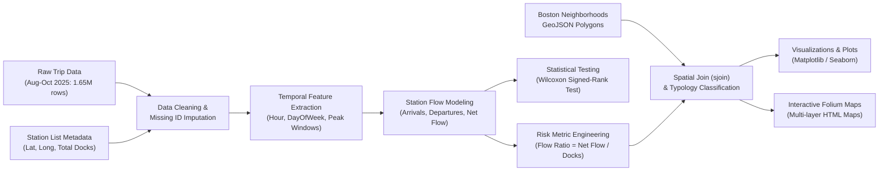

# 🚲 Bluebikes Station Imbalance & Commuting Spatial Dynamics Analysis

[](https://www.python.org/)
[](https://pandas.pydata.org/)
[](https://geopandas.org/)
[](https://python-visualization.github.io/folium/)
[](#)

> **Author**: Linlin Fan  
> **Course**: DAMG6105 Data Science Engineering with Python  
> **Instructor**: Dr. Handan Liu  

---

## 📌 Executive Summary

Urban bike-sharing systems frequently suffer from severe supply-demand spatial-temporal mismatches: residential stations empty out during morning commutes while commercial and university hubs become saturated, reversing directions during evening peak hours. 

This project conducts an in-depth spatial-temporal analysis of **1.6+ million trips** across the **Greater Boston Bluebikes** regional bike-sharing network over a three-month period (August – October 2025). By integrating trip logs, station capacity metadata, and Boston municipal neighborhood boundary GIS data, this study:
1. **Statistically proves** significant operational divergence between morning (7:00–9:00 AM) and evening (4:00–7:00 PM) peak hours (Wilcoxon Signed-Rank Test: $p = 2.34 \times 10^{-6}$).
2. **Quantifies station vulnerability** by defining dock-capacity normalized metrics: **Morning Empty-Station Risk** and **Evening Full-Station Risk**.
3. **Identifies critical "Tidal Stations"** that suffer from both extreme bike depletion in the morning and dock starvation in the evening.
4. **Validates urban spatial clustering**, demonstrating how land use (Residential vs. Commercial vs. University/Tech vs. Medical) governs bike flow.
5. **Delivers interactive geospatial decision-support maps** (`Folium`) and targeted operational rebalancing recommendations.

---

## 🗺️ Interactive Maps Preview

The project generates interactive HTML maps visualizing station risks and flow reversals across Greater Boston:

- **Greater Boston Network Map**: [`boston bluebikes three month data analysis/bluebikes_risk_map.html`](file:///Users/linlinfan/data_analytics_project/data_analytics_project/boston%20bluebikes%20three%20month%20data%20analysis/bluebikes_risk_map.html) (covers all 583 active stations).
- **Boston Municipal Neighborhood Map**: [`boston bluebikes three month data analysis/boston_risk_map.html`](file:///Users/linlinfan/data_analytics_project/data_analytics_project/boston%20bluebikes%20three%20month%20data%20analysis/boston_risk_map.html) (covers 338 Boston stations matched with neighborhood boundaries).

### Map Features:
- 🔴 **Red Circles (Morning Peak)**: Empty-station risk (shortage of available bikes). Radius & opacity scale with risk severity.
- 🔵 **Blue Circles (Evening Peak)**: Full-station risk (shortage of open docks). Radius & opacity scale with risk severity.
- 🟢 / 🟣 **Green / Purple Circles (Imbalance & Reversal)**:
  - 🟢 **Green**: Residential tidal pattern ($\text{Net Flow}_{\text{morning}} < 0$, $\text{Net Flow}_{\text{evening}} > 0$).
  - 🟣 **Purple**: Commercial / employment reverse-tidal pattern ($\text{Net Flow}_{\text{morning}} > 0$, $\text{Net Flow}_{\text{evening}} < 0$).
- 🎛️ **Layer Control & Interactive Tooltips**: Hover over stations to view station name, municipality, neighborhood, capacity, and net flow metrics.

---

## 📊 Key Findings

### 1. Morning vs. Evening Commuting Reversal
- **Weekday Commute Dominance**: Weekdays exhibit pronounced bi-modal demand peaks at **7:00–9:00 AM** and **4:00–7:00 PM** (evening peak volume is more than double morning peak: ~342k vs. ~153k trips). On weekends, the dual-peak structure disappears into a smooth midday recreational curve.
- **Statistical Significance**: A paired Wilcoxon Signed-Rank Test on station net flows confirmed significant behavioral shifts ($W = 65,180.50$, $p = 2.34 \times 10^{-6} < 0.05$).
- **Distribution Shift**:
  - **Morning Peak**: Left-skewed distribution, median station net flow = **-27.0** (majority of stations experience net bike outflow).
  - **Evening Peak**: Right-skewed distribution, median station net flow = **+28.0** (bikes return back to origin stations).
- **Commuter Patterns across 583 Stations**:
  - **55.6% (324 stations)**: Commuter Tidal Pattern (Morning Outflow $\to$ Evening Inflow).
  - **28.8% (168 stations)**: Commercial / Destination Pattern (Morning Inflow $\to$ Evening Outflow).
  - **7.2% / 6.7%**: Stations experiencing persistent outflow or inflow across both peak windows.

---

### 2. High-Risk Stations: Empty vs. Full

#### Metric Formulation:
$$\text{Net Flow} = \text{Arrivals} - \text{Departures}$$
$$\text{Flow Ratio} = \frac{\text{Net Flow}}{\text{Total Docks}}$$

#### A. Top Morning "Empty Risk" Stations (Severe Bike Outflow):
Stations with large negative flow ratios experience high probability of zero-bike availability for commuters:
1. **Old Morse Park at Putnam Ave (Cambridge)**: Flow Ratio = -42.5 (15 docks, -638 net flow)
2. **Dana Park (Cambridge)**: Flow Ratio = -41.7 (19 docks, -793 net flow)
3. **MIT Vassar St (Cambridge)**: Flow Ratio = -41.1 (53 docks, -2,176 net flow)
4. **Kennedy-Longfellow School (Cambridge)**: Flow Ratio = -40.6 (19 docks, -772 net flow)
5. **W Broadway at D St (Boston - South Boston)**: Flow Ratio = -38.0 (23 docks, -873 net flow)
*Insight*: High-density residential zones and student dormitories around Harvard and MIT experience severe morning depletion as students and staff ride to classes and offices.

#### B. Top Evening "Full Risk" Stations (Severe Dock Shortage):
Stations with high positive flow ratios face dock saturation, preventing returning commuters from returning bikes:
1. **Inman Square at Springfield St (Cambridge)**: Flow Ratio = +39.2 (25 docks, +981 net flow)
2. **Valenti Way at Haverhill St (Boston)**: Flow Ratio = +34.2 (24 docks, +822 net flow)
3. **W Broadway at D St (Boston - South Boston)**: Flow Ratio = +33.9 (23 docks, +779 net flow)
4. **Cambridge DPW - 147 Hampshire St (Cambridge)**: Flow Ratio = +33.0 (19 docks, +627 net flow)
5. **Sennott Park Broadway at Norfolk St (Cambridge)**: Flow Ratio = +31.7 (19 docks, +603 net flow)

#### C. The "Tidal Station" Phenomenon:
Several critical stations appear in **both the Top 10 Empty Risk and Top 10 Full Risk** rankings:
- **W Broadway at D St (Boston)**: Morning net flow -873 $\to$ Evening net flow +779 (Reversal: **+1,652**)
- **Cambridge Dept. of Public Works**: Morning net flow -653 $\to$ Evening net flow +627 (Reversal: **+1,280**)
- **Sennott Park Broadway at Norfolk St**: Morning net flow -686 $\to$ Evening net flow +603 (Reversal: **+1,289**)
- *Boston Internal*: **5 stations** exhibit simultaneous high empty & full risk, indicating a strongly closed-loop commuting pattern within Boston proper.

---

### 3. Spatial Clustering & Urban Land-Use Typology

By overlaying station locations with Boston's official municipal boundary polygons via GeoPandas spatial join (`gpd.sjoin`), stations were grouped into functional land-use categories:

| Land-Use Typology | Station Count | Avg. Morning Net Flow | Avg. Evening Net Flow | Avg. Flow Reversal ($\Delta$) | Primary Dynamics |
| :--- | :---: | :---: | :---: | :---: | :--- |
| **Residential** | 336 | **-84.91** | **+84.99** | **+169.90** | Classic Tidal: Outward morning rush, evening influx |
| **Commercial / Downtown** | 103 | **+167.19** | **-155.93** | **-323.13** | Reverse Tidal: Major employment attractor in AM, disperses in PM |
| **University / Tech** | 92 | **+90.28** | **-128.80** | **-219.09** | Heavy morning campus influx (Kendall / Harvard / MIT), evening departure |
| **Mixed / Medical** | 52 | **+57.73** | **-12.42** | **-70.15** | Balanced / specialized operational profile |

#### Notable Anomaly — Longwood Medical Area:
- The **Longwood Medical Area** demonstrated the single largest net influx in the entire system during morning peak (**+605.0**) and the largest net outflow in the evening (**-731.57**, Reversal: **-1,336.57**), even exceeding Downtown Boston.
- *Reason*: Massive healthcare employment hub (Brigham and Women’s, Boston Children’s, Beth Israel Deaconess) functioning as a concentrated employment destination.

---

## 🛠️ Data Pipeline & Methodology



1. **Data Ingestion**: Concat 3 monthly trip records from Hubway AWS S3 bucket.
2. **Station Identity Resolution**: Resolved missing station ID entries by bidirectional cross-referencing with station name-to-number mappings from `-External-_11.17.25_Bluebikes_Station_List.csv`.
3. **Filtering**: Removed deactivated stations (0 docks) and unmatched test entries, retaining 1,618,024 clean trips across 583 valid stations.
4. **Temporal Partitioning**:
   - Filtered weekdays vs. weekends.
   - Morning peak: trips starting between `07:00` and `08:59`.
   - Evening peak: trips starting between `16:00` and `18:59`.
5. **Spatial Join**:
   - Converted station coordinates into `GeoDataFrame` (`EPSG:4326`).
   - Performed point-in-polygon spatial join (`gpd.sjoin`) against City of Boston neighborhood boundaries.

---

## 💡 Operational Recommendations for Bluebikes Management

1. **Pre-Peak Rebalancing (Morning Window: 05:30 – 07:00 AM)**:
   - Prioritize proactive bike dispatching to high-risk residential corridors (Allston, South Boston, Brookline, and Cambridge residential neighborhoods) to prevent morning dock outages.
2. **Post-Peak Rebalancing (Evening Window: 19:30 – 22:00 PM)**:
   - High dock-occupancy mitigation: Dispatch vans to extract surplus bikes from saturated residential stations (e.g., Inman Square, W Broadway) back to maintenance depots or commercial centers.
3. **Targeted Dock Capacity Expansion**:
   - Stations such as *W Broadway at D St*, *South End Library*, and *Commonwealth Ave at Griggs St* operate on standard 15-to-23 dock capacities while experiencing turnover ratios exceeding $30\times$. Expanding physical dock capacity at these locations will directly reduce failure rates.
4. **Incentive-Based User Rebalancing ("Reverse-Commute Rewards")**:
   - Deploy dynamic in-app pricing discounts or credit incentives for users who ride bikes from commercial hubs back toward residential peripheries during morning peak hours.

---

## 📂 Project Structure

```text
data_analytics_project/
├── README.md                                          # Project documentation and analysis summary
└── boston bluebikes three month data analysis/
    ├── DAMG6105-PRJ1-AllArea-final (2) (1) (1) (7).ipynb  # Primary Jupyter analysis notebook
    ├── Boston Blue Bike Data Analysis.pdf             # Complete exported project report
    ├── bluebikes_risk_map.html                        # Greater Boston 583-station interactive risk map
    ├── boston_risk_map.html                           # Boston municipal neighborhood interactive risk map
    ├── -External-_11.17.25_Bluebikes_Station_List.csv # Bluebikes station capacity & coordinates
    ├── 202508-bluebikes-tripdata.csv                  # August 2025 trip data
    ├── 202509-bluebikes-tripdata.csv                  # September 2025 trip data
    └── 202510-bluebikes-tripdata.csv                  # October 2025 trip data
```

---

## 🚀 Getting Started & Reproduction

### Prerequisites
- Python 3.10 or higher
- Jupyter Notebook / JupyterLab

### Installation
Clone the repository and install the required dependencies:

```bash
git clone https://github.com/your-username/data_analytics_project.git
cd data_analytics_project

# Install required Python packages
pip install pandas numpy matplotlib seaborn scipy geopandas folium requests
```

### Running the Analysis
1. Navigate to the project directory:
   ```bash
   cd "boston bluebikes three month data analysis"
   ```
2. Launch Jupyter Notebook:
   ```bash
   jupyter notebook "DAMG6105-PRJ1-AllArea-final (2) (1) (1) (7).ipynb"
   ```
3. Run all cells sequentially. The notebook will automatically clean the data, generate analytical figures, and export the interactive HTML maps (`bluebikes_risk_map.html` and `boston_risk_map.html`).
4. To view the maps, open the `.html` files in any web browser.

---

## 📜 Course & Academic Reference

- **Course**: DAMG6105 Data Science Engineering with Python
- **Institution**: Northeastern University
- **Instructor**: Dr. Handan Liu
- **Data Sources**:
  - [Bluebikes System Data](https://bluebikes.com/system-data)
  - [Hubway AWS S3 Trip Data Archive](https://s3.amazonaws.com/hubway-data/index.html)
  - [City of Boston Neighborhood Boundaries GeoJSON](https://data.boston.gov/dataset/boston-neighborhood-boundaries)
